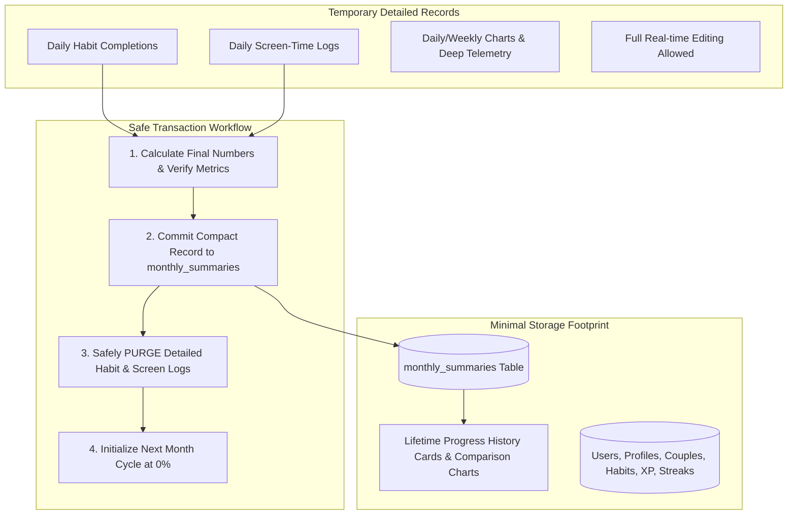

# Nexora
### *A Lifetime Couple Growth & Habit Tracking Platform*
> **"Two individuals. One journey. Better every month."**

---

## 🏛️ System Architecture: Minimal Monthly Data Retention

To support decades of continuous daily usage without database bloat or storage runaway, **Nexora** uses a strict **Two-Layer Monthly Snapshot Architecture**:



---

## 🔒 1. Two Distinct Data Layers

### Layer A: Active-Month Data (Temporary)
During the active month (e.g., *November 2026*):
- Full daily habit completion checkmarks.
- Detailed daily screen-time logs across 6 categories.
- Real-time Recharts visualizations and daily trend analytics.
- Full editing privileges for both partners until finalized.

### Layer B: Monthly-Summary Data (Permanent)
When month-end finalization occurs, the system records **ONLY** the compact summary metrics:
```json
{
  "month": "November",
  "year": 2026,
  "month_year": "2026-11",
  "partner_a_completion": 99.0,
  "partner_b_completion": 100.0,
  "couple_completion": 99.5,
  "partner_a_screen_time_avg": 270,
  "partner_b_screen_time_avg": 300,
  "total_habits_completed": 420
}
```

### What is Permanently Purged at Month-End:
- ❌ All individual daily habit checkmarks from finalized months.
- ❌ Daily screen-time logs from finalized months.
- ❌ Old daily charts and detailed logs.

### What is Permanently Preserved:
- ✅ Permanent compact monthly summaries (`monthly_summaries` records).
- ✅ User accounts, authentication, and profiles.
- ✅ Couple shared workspace, anniversary, and invite codes.
- ✅ Lifetime couple streaks and user XP/levels.
- ✅ Active habit definitions (carried forward into the new month).

---

## 🔄 2. Transactional Month Finalization Workflow

Finalization can be triggered **manually** or **automatically** at the turn of a month:

1. **Calculate**: Evaluates final percentages for Partner A, Partner B, and Couple Average.
2. **Verify**: Ensures summary metrics are complete and validated before modifying tables.
3. **Commit**: Saves the compact record into `monthly_summaries`.
4. **Purge**: Safely deletes all temporary daily records for that month.
5. **Fresh Cycle**: Creates the new month cycle (`2026-12`), resets daily completion percentages to `0%`, resets monthly streaks, and carries forward active habits.
6. **Safety Guarantee**: If offline or if verification fails, records are preserved untouched until finalization succeeds.

---

## 📜 3. Lifetime Progress History

The **Lifetime History** page renders clean, lightweight comparison cards:
- **October 2026**: You 85%, Partner 92%, Couple 88.5% (Finalized)
- **November 2026**: You 96%, Partner 98%, Couple 97.0% (Active / In Progress)
- **December 2026**: You 0%, Partner 0%, Couple 0.0% (Upcoming)

A simplified multi-month Bar Chart displays long-term couple growth trajectory rendered directly from compact summary rows, requiring zero daily log storage!

---

## 🚀 4. Quick Start & Local Development

```powershell
# Run the local Vite dev server
cmd.exe /c "npm run dev"

# Build production bundle
cmd.exe /c "npm run build"
```
The application runs live on **[http://localhost:5173/](http://localhost:5173/)**.

---

## 📱 5. Android APK & Friend Deployment Guide

### Option A: Cloud APK Build via GitHub Actions (Recommended)
This repository includes a ready-to-run GitHub Actions workflow in `.github/workflows/build-apk.yml`:
1. Push your repository to GitHub (`git push origin main`).
2. Go to your GitHub repository &rarr; click **Actions** &rarr; select **"Build Android APK"**.
3. Click **"Run workflow"**.
4. GitHub's cloud runners will build the APK in ~2 minutes using Java 17 and Android SDK.
5. Download **`Nexora.apk`** from the workflow Artifacts and send it to your friend!

### Option B: Instant Mobile WebAPK (Zero File Download)
1. Deploy your app to Vercel or Netlify (free 1-click deploy).
2. Send the URL to your friend.
3. On their Android phone (Chrome / Brave / Edge), tap the 3 dots &rarr; tap **"Install App"** or **"Add to Home Screen"**.
4. Android creates a native WebAPK with full offline support, custom app icon, and standalone launch.

### Option C: Local Android Studio Build
```powershell
# Sync Android native assets
npx cap sync android

# Build Debug APK using Gradle
cd android
./gradlew assembleDebug
# Generated APK: android/app/build/outputs/apk/debug/app-debug.apk
```

---

## 🤝 6. Inviting Registered Members
1. Open the **Partner Connection** modal (click **Connect Partner** in the Navbar or in Settings).
2. Under the **"Application Members"** tab, search for any registered user in the application.
3. Click **"Connect"** next to their name to send a partner invitation.
4. When they log in, they will see a prominent **Partner Request Banner** on their dashboard and can tap **"Accept & Connect"** to link your accounts with shared couple streaks and synergy rings!
